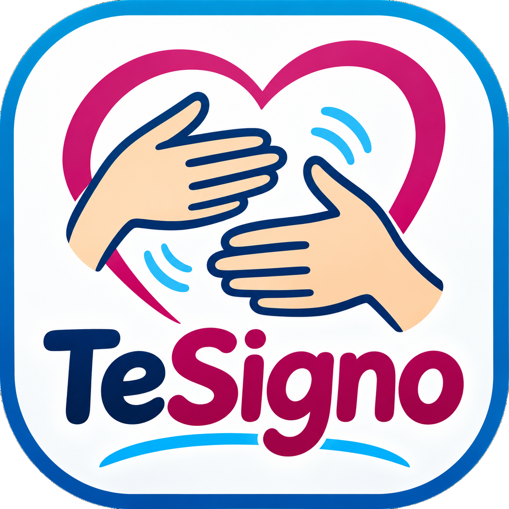

# TeSigno
<p align="center">

</p>

[Repositorio del proyecto](https://github.com/entreunosyceros/tesigno) · [Cómo contribuir](CONTRIBUTING.md) · [Licencia](LICENSE)

**Una forma sencilla de entendernos.** Aplicación Android gratuita, inicialmente para que dos personas mayores puedan comunicarse con su nieto mediante expresiones cotidianas y vídeos en lengua de signos española (LSE). **No es un traductor automático**: reproduce grabaciones previamente preparadas y revisadas.

## Utilización diaria

<p align="center">

</p>

- Cabecera con el logo original y acceso visible a Ajustes.
- Cuatro categorías y 14 expresiones iniciales. Las categorías empiezan contraídas y funcionan como un acordeón: abrir una cierra la anterior; tocarla otra vez la contrae.
- Botones de 56–80 dp como mínimo, textos adaptables, estado de apertura para TalkBack y animación breve de despliegue. Se conserva la categoría abierta y la posición del catálogo al volver del reproductor.
- Tema oscuro turquesa por defecto; se puede activar el tema claro en Ajustes.
- Vídeo automático en bucle, con imagen completa sin recorte, Repetir y Volver. Se pausa al salir al segundo plano y libera los recursos al abandonar la pantalla.
- Logo, splash de tres segundos y Acerca de con enlace al repositorio.

La selección de expresiones y todos los vídeos guardados funcionan **sin conexión**. No hay cuentas, servidores, publicidad ni analítica. El enlace de GitHub se abre en un navegador externo y requiere conexión. No se incluyen vídeos de LSE de terceros: las expresiones sin archivo muestran «Vídeo pendiente de incorporar».

## Gestión de categorías

<p align="center">

</p>

Abre **Ajustes → Gestionar categorías y expresiones → Categorías**:

- Crear o editar nombre e icono entre seis opciones sencillas.
- Consultar el número de expresiones y si la categoría es personal o incorporada.
- Ordenar con Subir y Bajar, sin gestos ocultos.
- Eliminar con confirmación. Si tiene expresiones, puedes trasladarlas a otra categoría o confirmar explícitamente la eliminación conjunta. Cancelar conserva el contenido anterior.

Se rechazan los nombres vacíos y los duplicados de categoría sin distinguir mayúsculas. Los colores siguen el tema para mantener contraste; no se añade un selector de colores individual opcional.

## Gestión de expresiones

<p align="center">

</p>

En **Ajustes → Gestionar categorías y expresiones → Expresiones**, selecciona la categoría:

- Crea expresiones sin exigir vídeo inicial.
- Edita el texto o cambia la categoría conservando el ID estable.
- Ordena dentro de la categoría con Subir y Bajar.
- Previsualiza vídeos y elimina expresiones mediante confirmación.
- En el formulario, graba, importa, sustituye o quita la asociación del vídeo.

Guardar confirma los cambios; Cancelar o Atrás solicita descartar el borrador. El vídeo anterior permanece asociado hasta que el nuevo guardado termina correctamente. Los textos idénticos dentro de una categoría se rechazan al guardar, salvo asociaciones previas resultantes de un traslado de categoría.

## Grabación e importación

**Grabar vídeo** utiliza la aplicación de cámara instalada y `ActivityResultContracts.CaptureVideo`, con una URI temporal de FileProvider limitada a la carpeta de borradores. No se solicita permiso de cámara ni micrófono. Si no hay una aplicación de cámara compatible se muestra un error.

**Elegir de la galería** utiliza `PickVisualMedia(VideoOnly)`: AndroidX selecciona el Photo Picker disponible o un selector de documentos compatible en sistemas anteriores. No se solicitan permisos generales de almacenamiento. Se copia el archivo al almacenamiento privado; no depende permanentemente de su URI original.

Cada archivo debe tener contenido de vídeo reconocible por Android y ocupar como máximo **500 MB**. Se comprueban apertura, tamaño y pista de vídeo. Esto no garantiza que todos los códecs sean reproducibles en todos los dispositivos: la vista previa permite comprobarlo. Se recomienda MP4/H.264. No se realiza transcodificación.

El nuevo vídeo se puede previsualizar antes de Guardar. Cancelar la cámara o el selector conserva la asociación anterior. Las importaciones se realizan fuera del hilo principal, con indicador de procesamiento y acciones desactivadas para evitar dobles guardados.

## Persistencia y actualizaciones

Se mantiene el catálogo original `app/src/main/assets/expressions.json`. En el primer arranque se crea `files/catalog.json` en el almacenamiento privado de Android. Incluye categorías, expresiones, orden de las listas, iconos y los IDs de contenido incorporado conocido. No se utiliza Room: el tamaño del catálogo permite una solución JSON pequeña y comprobable.

- Guardado mediante archivo temporal, sincronización del contenido y renombrado en el mismo directorio. El catálogo en memoria solo cambia después del guardado correcto.
- Los IDs son estables e independientes del nombre. Los nuevos son `user_` seguidos de un UUID sin guiones.
- Los archivos de usuario se guardan en `files/videos/` con referencias `private:user_<uuid>.mp4`.
- Los borradores de vídeo van a `files/staging/`, fuera de la caché. Se mantienen durante cámara, rotación y restauración de formularios. No se escriben referencias de borrador en el catálogo definitivo.
- Al guardar una sustitución se prepara el archivo nuevo, se confirma el catálogo y después se limpian los vídeos sin referencias. Los borradores cancelados se eliminan inmediatamente; los abandonados por cierres abruptos se limpian tras 24 horas en un arranque u operación posterior, respetando el borrador restaurado.
- Si el proceso termina entre la preparación del vídeo y el guardado, la próxima limpieza retira el archivo sin referencia.
- Una actualización agrega únicamente IDs incorporados que aún no eran conocidos. No sobreescribe las ediciones ni resucita elementos borrados intencionadamente. Si una expresión nueva pertenece a una categoría incorporada que el usuario ya eliminó, no se reintroduce esa categoría ni su contenido.
- Un JSON personal dañado o de una versión desconocida muestra un error y **no se reemplaza por los valores iniciales**. No hay un botón de restablecimiento que borre los datos.

Los datos sobreviven al cierre, reinicio y actualización mediante `adb install -r` con el mismo identificador y firma. **Desinstalar, borrar los datos de Android o cambiar la firma puede hacer perder el contenido**. No hay exportación, sincronización ni copias en la nube; las copias del sistema están desactivadas. Conserva aparte las grabaciones originales y no desinstales para actualizar.

## Contenido incorporado y vídeos autorizados

El JSON de assets contiene `categories` y `expressions`:

```json
{
  "categories": [{"id": "saludos", "text": "Saludos", "icon": "hand"}],
  "expressions": [
    {"id": "hola", "text": "Hola", "category": "saludos", "video": "hola.mp4"}
  ]
}
```

Los iconos válidos son `chat`, `hand`, `cup`, `home`, `heart`, `star`. El icono es opcional para mantener compatibilidad con el catálogo inicial. Los IDs deben ser únicos, comenzar por letra minúscula y contener letras ASCII minúsculas, números y guion bajo. El texto es obligatorio y cada expresión debe apuntar a una categoría existente. Los nombres de MP4 incorporados siguen las mismas reglas, sin rutas ni URLs.

Para incorporar vídeos en una distribución, guarda las grabaciones **autorizadas y revisadas por personas competentes en LSE** en `app/src/main/assets/videos/` con el nombre exacto declarado. El orden de las listas determina el orden inicial. Las actualizaciones no sobrescriben cambios personales del catálogo ya guardado.

No descargues materiales de SpreadTheSign, DILSE ni otras fuentes sin autorización. No generes signos artificiales ni supongas que una ilustración representa un signo válido.

## Compilación e instalación

Android mínimo: **6.0 / API 23**. Entorno: JDK 17 o 21, SDK Android 36 y Build Tools 36.0.0. Se mantienen Gradle 9.3.1, AGP 9.1.0 y Kotlin integrado 2.2.10. Las dependencias Lifecycle para conservar estado usan la misma versión 2.8.7 ya utilizada en el proyecto. La primera compilación necesita conexión para descargar dependencias.

```sh
# Ajusta la ruta a tu instalación; no se versiona este archivo.
printf 'sdk.dir=/ruta/al/Android/Sdk\n' > local.properties
./gradlew clean testDebugUnitTest assembleDebug
./gradlew lintDebug
adb install -r app/build/outputs/apk/debug/app-debug.apk
```

Windows: sustituye `./gradlew` por `gradlew.bat`. Puedes abrir esta carpeta en Android Studio compatible con AGP 9.1.

**APK debug:** `app/build/outputs/apk/debug/app-debug.apk`.

Las pruebas Android adicionales requieren un dispositivo o emulador:

```sh
./gradlew connectedDebugAndroidTest
```

Estas pruebas trabajan en una carpeta aislada de caché y usan un MP4 técnico de color sólido del APK de tests, sin signos ni grabaciones de personas. No incorporan este vídeo al catálogo ni al APK de la aplicación.

## Archivos principales

- `data/Catalog.kt`: modelos, validación y referencias de vídeo.
- `data/ContentStore.kt`: operaciones de gestión, acordeón, serialización y persistencia comprobable en JVM.
- `data/ContentViewModel.kt`: carga, estado de borrador restaurable y operaciones de disco fuera del hilo principal.
- `ui/TeSignoApp.kt`: navegación, catálogo acordeón y ajustes.
- `ui/ContentScreens.kt`: formularios, gestión, confirmaciones y contratos de cámara/selector.
- `media/MediaFiles.kt`: importación, validación, promoción y limpieza de archivos privados.
- `media/ExpressionPlayer.kt`: reproductor Media3 existente, ampliado para resolver archivos privados y volver al formulario.
- `MainActivity.kt`: actividad y splash existentes.
- `res/xml/file_paths.xml`: alcance limitado de FileProvider.

Todos los archivos Kotlin anteriores están bajo `app/src/main/java/es/tesigno/`.

## Logo e iconos

Se conserva `app/src/main/res/drawable/logo_tesigno.png`, los iconos y el splash de tres segundos. Para regenerar iconos después de sustituir el PNG (requiere Pillow): `python3 tools/generate_icons.py`.

## Pruebas y limitaciones

Consulta `VALIDACION.md` para los comandos ejecutados, sus resultados y las comprobaciones pendientes. Los tests JVM cubren catálogo, acordeón, operaciones, persistencia, cancelación, orden, asociaciones, actualización y errores de guardado. Los tests Android cubren archivos multimedia reales, cancelación de borradores y limpieza; no sustituyen comprobar la aplicación de cámara concreta del teléfono.

Pendiente validar accesibilidad y formularios con los usuarios destinatarios, cámaras de distintos fabricantes, falta real de espacio y todos los dispositivos antiguos. El proceso de importación no transcodifica vídeos y su duración depende del tamaño del archivo y del teléfono. No se incluyen favoritos, comunicación bidireccional, sincronización, intercambio, exportación ni edición visual de vídeos.

## Licencia y derechos de contenidos

Código bajo **GPL-3.0**, con el texto de la licencia en `LICENSE`. Esta licencia del código no concede automáticamente derechos sobre vídeos, logotipos ni otros contenidos. El logo procede del usuario del proyecto; sus derechos se mantienen separados. Deben conservarse las autorizaciones de cada grabación y de quienes aparecen en ella. No se distribuyen grabaciones de terceros sin autorización.

Referencias de las APIs utilizadas: [Photo Picker de Android](https://developer.android.com/training/data-storage/shared/photo-picker) y [CaptureVideo](https://developer.android.com/reference/androidx/activity/result/contract/ActivityResultContracts.CaptureVideo).

## Compilar y conservar solo el APK

En Linux/macOS ejecuta `./tools/build_debug.sh`.

Este comando limpia salidas anteriores y cachés locales del proyecto, ejecuta pruebas y Lint, compila el APK y muestra el resultado. Si termina correctamente elimina informes generados, archivos intermedios y cachés locales, conservando `app/build/outputs/apk/debug/app-debug.apk` y sus metadatos. Si falla, conserva los archivos de diagnóstico. No lo ejecutes durante otra compilación de este proyecto.

No elimina código, pruebas, documentación de uso y validación, dependencias globales, logo, vídeos ni datos de la aplicación instalada. Los informes de Gradle no se incluyen dentro del APK; esta limpieza reduce el espacio del proyecto en el ordenador. Para inspeccionar informes, usa los comandos Gradle manuales anteriores.


## Subir el proyecto a GitHub

El repositorio debe contener las fuentes, recursos autorizados, tests, documentación y Gradle Wrapper. `.gitignore` excluye las cachés, APK, carpetas build, configuración local y claves privadas. Conserva `gradle/wrapper/gradle-wrapper.jar`: es necesario para compilar sin instalar Gradle por separado.

Si empiezas desde una carpeta sin repositorio Git, crea primero un repositorio vacío en GitHub (sin generar otro README o licencia) y ejecuta:

```sh
git init -b main
git add .
git diff --cached --check
git status
git commit -m "Primera versión de TeSigno"
git remote add origin https://github.com/entreunosyceros/tesigno.git
git push -u origin main
```

Si ya existe un repositorio con historial, clónalo y copia los archivos del proyecto sobre esa copia antes de crear el commit. No fuerces el envío ni sustituyas el historial existente. Comprueba lo que vas a publicar con `git status`; `local.properties` y `app/build/` deben quedar fuera. Las reglas de ignore no retiran automáticamente archivos que ya estuvieran versionados.

Para distribuir un APK, adjúntalo aparte a una versión en GitHub Releases. No es necesario incluirlo en los commits. El APK debug es una compilación de prueba y cada entorno puede utilizar una firma de desarrollo diferente: conserva la misma clave para actualizar instalaciones existentes sin desinstalar.
